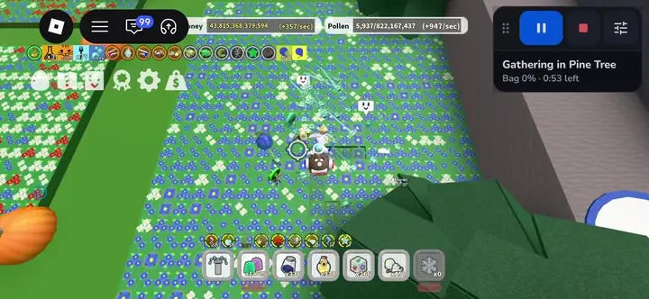
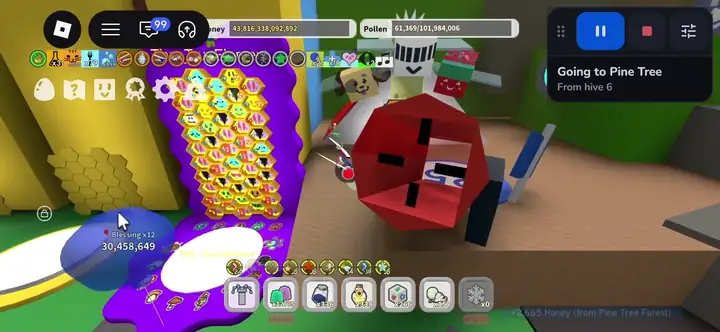
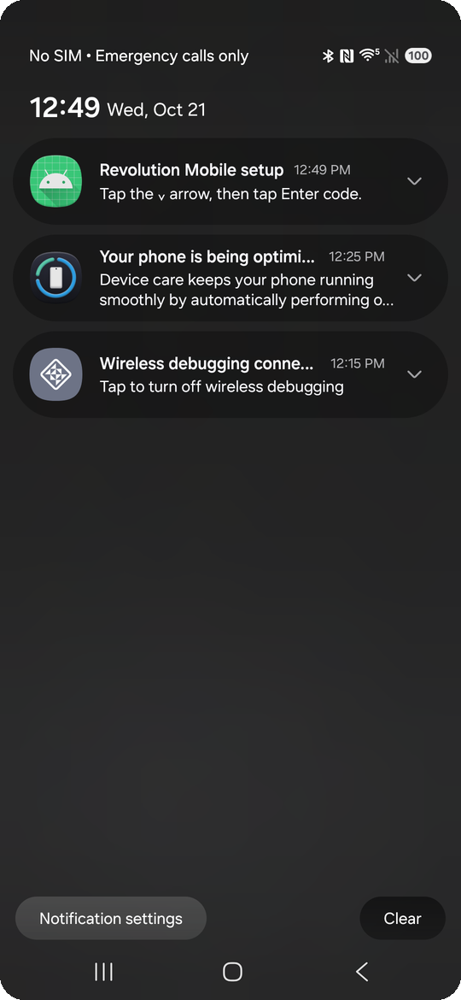
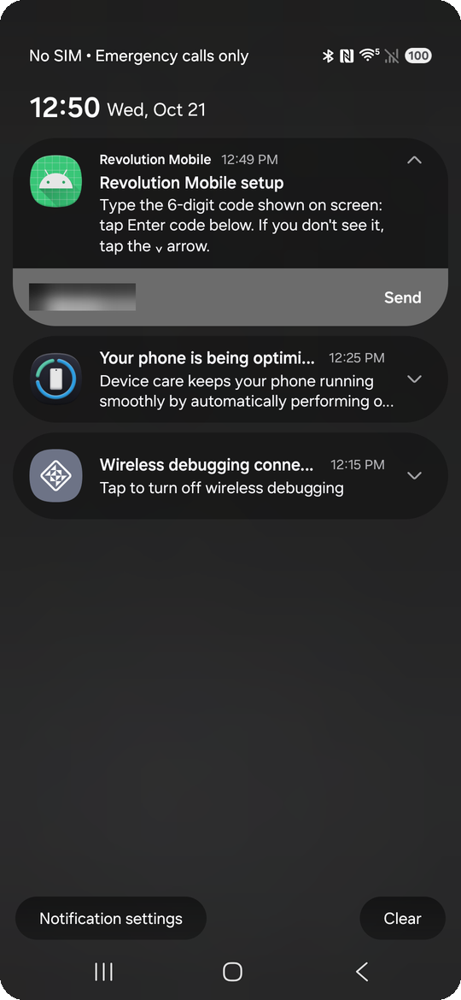
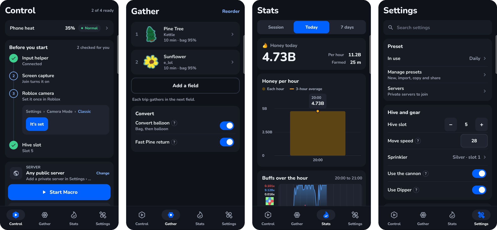
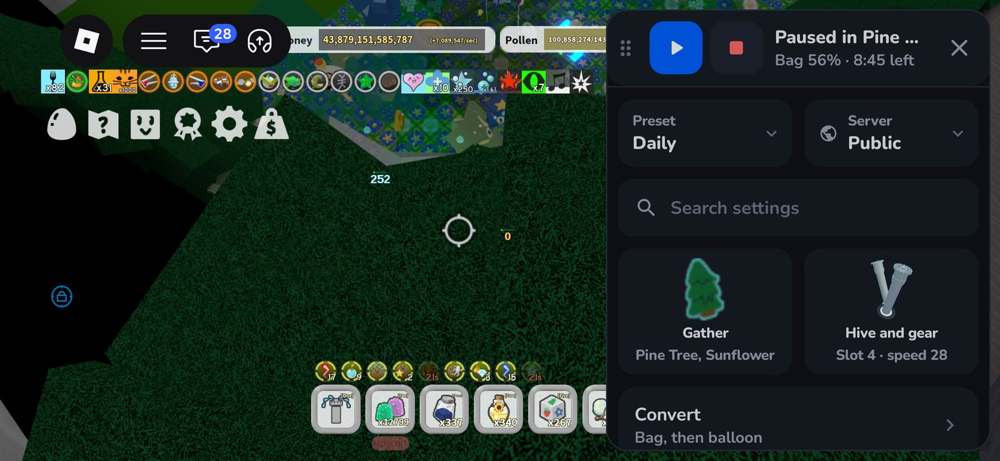
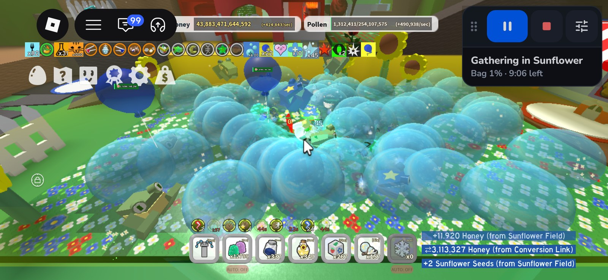
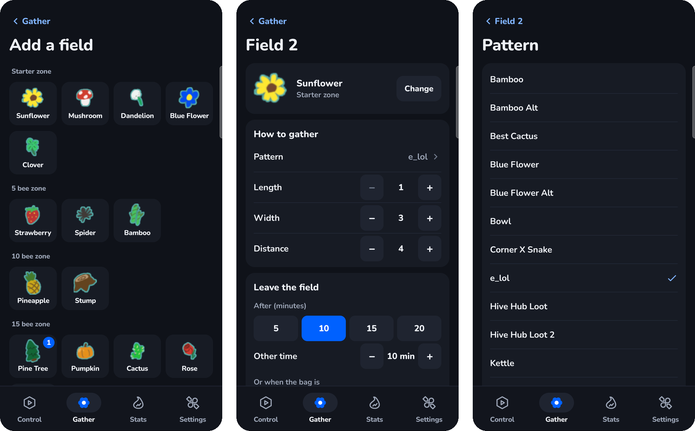

<h1 align="center">Revolution Mobile: Bee Swarm Simulator macro for Android</h1>

  
  
  

  <a href="https://github.com/nosyliam/RevolutionMobile/releases/latest"><b>Download</b></a> ·
  <a href="#set-it-up"><b>Set it up</b></a> ·
  <a href="docs/TROUBLESHOOTING.md"><b>Troubleshooting</b></a> ·
  <a href="https://revolutionmacro.com/docs/mobile/"><b>Docs</b></a>

  

**Revolution Mobile is a free Bee Swarm Simulator macro for Android.** It works just like any other macro: it reads your screen to understand where you are and what buffs you have, then moves your character with a simulated keyboard to gather at fields and make honey.

A lot of you have been asking for a way to macro without a PC. We know how frustrating it is to progress slower than your friends because you can't macro, and because of that we're bringing the features Bee Swarm players love from [Revolution Macro](https://github.com/nosyliam/revolution-macro) to a port made for mobile players.

## Download

**[Get the latest APK from Releases](https://github.com/nosyliam/RevolutionMobile/releases/latest)** and open it on your phone.

You need an Android phone or tablet on Android 11 or newer, Wi-Fi, and a Discord or Patreon account to sign in with. iPhones, emulators and cloud phones aren't supported.

## What it does

Tap **Start Macro** and it opens Bee Swarm Simulator, joins your server and claims a hive. From there it takes the cannon or walks to your field, drops your sprinklers and gathers with the pattern you picked. When your bag fills up or your time runs out, it heads home. Once home, it converts your bag and your balloon, then goes back out.

  

- 17 fields and 15 patterns, with up to 3 fields in a rotation
- Rejoins and claims a hive again if Roblox disconnects
- Blueberry, Strawberry and Coconut dispensers, Wealth Clock, Ant Pass, Robo Pass, Honey Storm and the field boosters
- Presets you can switch from inside the game, including the ones you made in Revolution Macro on PC
- Private servers, with a public server as the fallback
- Honey per hour and buff graphs for this session, today and the last 7 days
- Heat breaks: it closes the game when your phone runs hot and rejoins once it cools

Revolution Mobile is in beta, and we work on it every day. Next up: bug runs, quests and planters. We've spent the last two years building macros for PC, and we're excited to bring over the features you love.

## Set it up

Setup takes a few more taps than a normal app, and most of them happen once. The app shows each step and opens the right screen for you, so you won't have to dig through your settings.

1. [Download the APK](https://github.com/nosyliam/RevolutionMobile/releases/latest) on your phone and open it. If Android asks, allow your browser to install apps.
2. Sign in with Discord or Patreon.
3. Tap **Open About phone**, then tap **Build number** 7 times. That turns on Developer options. On a Samsung phone, Build number is under **Software information**.
4. Tap **Open Developer options**, tap the words **Wireless debugging**, turn it on and tap **Allow**.
5. Tap **Start pairing**, then **Pair device with pairing code** in Wireless debugging. Android shows a 6-digit code.
6. Without leaving Settings, pull down your notifications, tap **Enter code** on **Revolution Mobile setup** and type the code.
7. In Roblox, open **Settings** and set **Camera Mode** to **Classic**.
8. Back in the app, pick your field on the **Gather** tab and tap **Start Macro** on the **Control** tab.

  
  

The only part that's a little tricky is pairing. Android closes the code the moment you switch apps, which is why we put a box in your notifications for it. If you don't see **Enter code**, tap the **⌄** arrow on the notification.

After a phone restart, Android turns Wireless debugging off. Turn it back on and the app reconnects. You don't pair again.

The [full setup guide](docs/SETUP.md) has every screen, plus the extra switch that Xiaomi, OPPO and OnePlus phones need.

## Screenshots

  

  

  

  

## Why it needs Wireless debugging

Android has a rule that stops one app from pressing keys in another. The official way around it is Wireless debugging, a setting made for developers, so setup has you turn it on and pair the app with your own phone. No root, no second app, nothing to plug in.

The macro looks at your screen and presses keys. It never touches Roblox itself, and if you turn Wireless debugging off, its access is gone.

## Questions

**Can I leave it running overnight?** You can. Keep your phone plugged in and somewhere cool. If Roblox disconnects, the macro rejoins and carries on.

**Do I need a private server?** No, but it helps. On a public server someone else may be gathering in your field. Paste your server's link under **Settings › Servers** and pick it for your preset.

**Can I use my presets from PC?** Yes. Share the preset file to your phone and import it under **Settings › Manage presets**.

**Can I get banned?** Macros that press keys for you have been part of Bee Swarm Simulator for years. Revolution Mobile still automates your account, so read Roblox's rules and use it at your own risk.

The [FAQ](docs/FAQ.md) has the rest.

## If something goes wrong

| What you see | What to do |
|---|---|
| **Wireless debugging is off** | It turns off after a restart or a Wi-Fi change. Turn it on again in Developer options. |
| Your character curves into the wrong field | Open the panel, tap **More**, then **Fix Camera**. Then check **Move speed** under **Settings › Hive and gear**. |
| The floating controls don't show | Follow the **Allow floating controls** card on the **Control** tab. |
| Setup won't finish on a Xiaomi, Redmi or POCO phone | Turn on **USB debugging (Security settings)** in Developer options. |

[Troubleshooting](docs/TROUBLESHOOTING.md) covers everything else.

## Help

The [Discord](https://discord.gg/revolutionmacro) is where we answer questions and post updates. Found a bug? Open an [issue](https://github.com/nosyliam/RevolutionMobile/issues) with your phone model and Android version.

On PC? [Revolution Macro](https://github.com/nosyliam/revolution-macro) runs on Windows and macOS.

---

Revolution Mobile is not affiliated with Roblox Corporation or with Onett, the creator of Bee Swarm Simulator. Automating your account is at your own risk.
