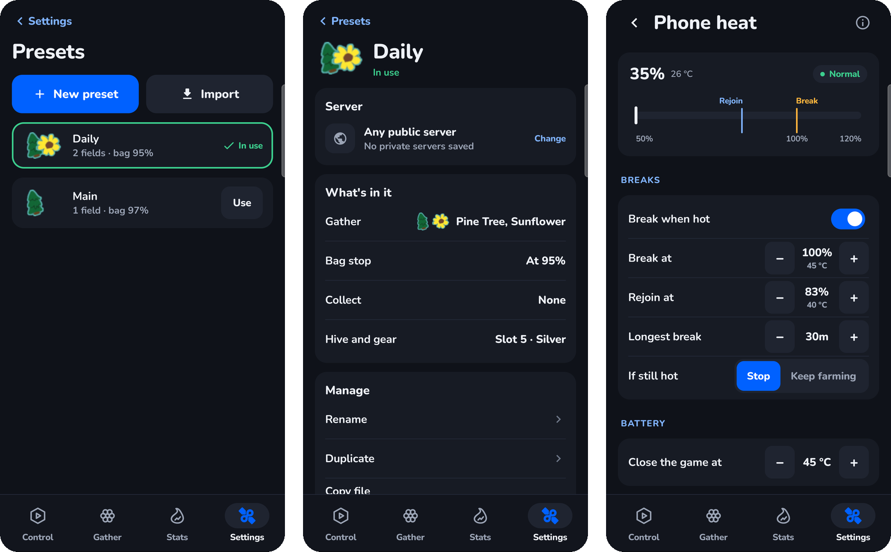

# Revolution Mobile FAQ: the Bee Swarm Simulator macro for Android

Short answers to what players ask most. For step-by-step help, see the [setup guide](SETUP.md) and [troubleshooting](TROUBLESHOOTING.md).

## The basics

### Is there a Bee Swarm Simulator macro for Android?

Yes. Revolution Mobile runs on Android 11 and newer, on phones and tablets, and it never needs a PC. People used to leave a computer on all night or run the game in an emulator. You don't have to do either anymore.

### Is Revolution Mobile free?

Yes, it's free. You sign in with Discord or Patreon, and then you're good to go. There are no keys to buy and no ads in the app.

### Where do I download it?

From the [Releases page](https://github.com/nosyliam/RevolutionMobile/releases/latest) of this repository. Download the `.apk` file under **Assets** on your phone and open it. Only download Revolution Mobile from here or from [revolutionmacro.com](https://revolutionmacro.com/).

### Does it work on iPhone or iPad?

No. iOS has nothing like Android's Wireless debugging, so the macro has no way to press keys there.

### Does it work on an emulator or a cloud phone?

Those aren't supported. Use a real Android phone or tablet.

### Which phones does it work on?

Any 64-bit phone or tablet with Android 11 or newer and Wi-Fi. Phones are the most tested. Xiaomi, OPPO, OnePlus and realme phones need one extra switch, and the app shows you which one. See [Phone-specific settings](SETUP.md#phone-specific-settings).

## Setup

### Do I need root, a PC or another app?

No. The app pairs with your phone's own Wireless debugging during setup, and after that it starts everything it needs by itself. There's no helper app to install from the Play Store and nothing to plug in.

### What is Wireless debugging, and why does the macro need it?

Wireless debugging is a setting Android made for app developers. It lets an app you've paired send key presses and taps to the phone, which is the only way Android allows one app to control another. Revolution Mobile pairs with it on your own phone, over your own Wi-Fi, so nothing outside the phone gets that access. To cut it off, turn Wireless debugging off, or remove Revolution Mobile from the **Paired devices** list.

### Do I have to pair again every time?

No, you pair once. After a phone restart or a Wi-Fi change, Android turns Wireless debugging off. Turn it back on and the app reconnects.

### Why does it need to capture my screen?

That's how the macro sees the game. It reads your hive, your bag, your buffs and the game's buttons from the screen, on your phone.

## Playing

### What does the macro do?

It joins Bee Swarm Simulator, claims a hive, walks to your field, places your sprinklers and gathers with a pattern. When your bag is full or your time is up, it goes back to your hive, makes honey and heads out again. On the way it can collect dispensers, Wealth Clock, passes and field boosters.

### Does it do quests, planters or bug runs?

Not yet. Revolution Mobile is in beta, and those are what we're working on next. For now it gathers, makes honey and collects dispensers, passes and boosters.

### Which fields can it gather in?

All 17 gathering fields: Sunflower, Mushroom, Dandelion, Blue Flower, Clover, Strawberry, Spider, Bamboo, Pineapple, Stump, Pine Tree, Pumpkin, Cactus, Rose, Mountain Top, Pepper Patch and Coconut. You can put up to 3 in a rotation.

### Do I need a private server?

You don't need one, but it helps. On a public server someone else may be gathering in your field, and a full server can leave you without a hive. If you have a private server, paste its link into the app under **Settings › Servers** and pick it for your preset. After that, **Start Macro** joins that server, and the macro goes back to it after a disconnect.

### What is a preset?

A preset is everything the macro needs to know about one way of playing: your fields and their patterns, your hive slot, your move speed, your sprinkler and what to collect. Make one for each account or each goal, and switch between them from the panel without leaving the game. You can also share a preset as a file, which is an easy way to give a friend a setup that works.

  

### Can I use my presets from Revolution Macro on PC?

Yes. Share the preset file to your phone, open **Settings › Manage presets › Import**, and choose it. Your fields, patterns and hive settings come with it.

### Can I leave it running overnight?

You can. If Roblox disconnects, the macro joins again, claims a hive and keeps going. Keep the phone plugged in and somewhere cool.

### My phone gets hot. Is that a problem?

Roblox works a phone hard, and a hot phone slows itself down. Revolution Mobile watches your phone's heat. At the limit you set, the macro converts, closes the game, waits for the phone to cool and then rejoins. The limits are under **Settings › Display › Phone heat**.

### Can I use my phone while the macro runs?

Not for anything else. Roblox has to stay in front, because the macro presses keys in whatever is on screen. Pause it from the floating controls first.

## Safety

### Can I get banned for using a macro in Bee Swarm Simulator?

Macros that press keys for you have been part of Bee Swarm Simulator for years, and the game's developer has said publicly that gathering with one is fine. Revolution Mobile still automates your account, so read Roblox's rules and use it at your own risk.

### Does it change Roblox or my account?

No. The macro doesn't modify Roblox, inject anything into the game or read its memory. It can only see what's on your screen and press what you could press yourself. It never asks for your Roblox password.

### What does the app send?

It checks your sign-in and looks for updates. It also sends crash reports and diagnostics to Revolution so bugs can be found and fixed: the app's log, your phone model, your Android version and what step the macro was on. It doesn't hold your password, and there are no ads. You can turn crash reports off under **Settings › Help**.

### How do I remove it?

Uninstall the app like any other. To remove its pairing as well, open **Developer options › Wireless debugging › Paired devices** and forget Revolution Mobile, or turn Wireless debugging off.

## More

### Is there a PC version?

Yes. [Revolution Macro](https://github.com/nosyliam/revolution-macro) is the Bee Swarm Simulator macro for Windows and macOS.

### Where can I get help or suggest something?

The [Discord](https://discord.gg/revolutionmacro) is the fastest. You can also open an [issue](https://github.com/nosyliam/RevolutionMobile/issues).

[Back to the README](../README.md)
