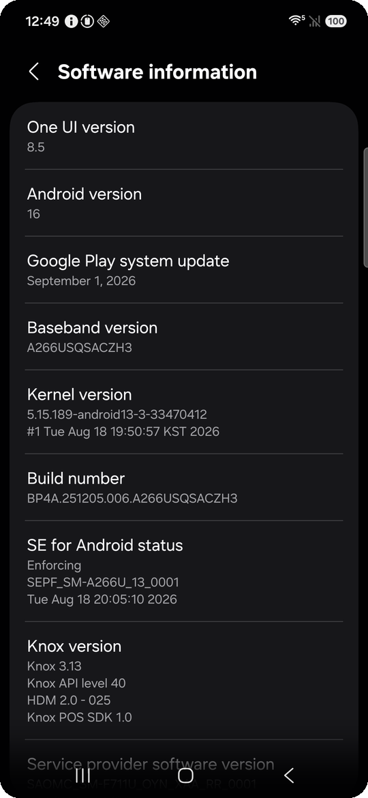
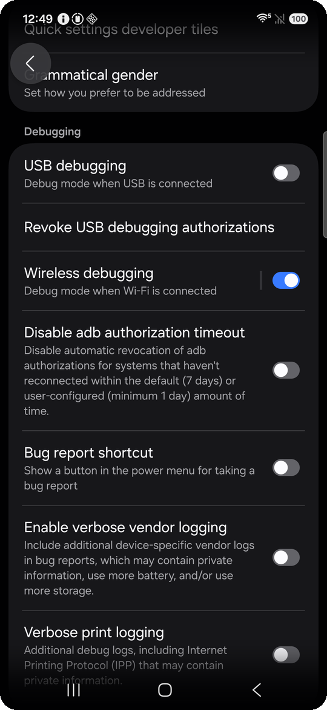
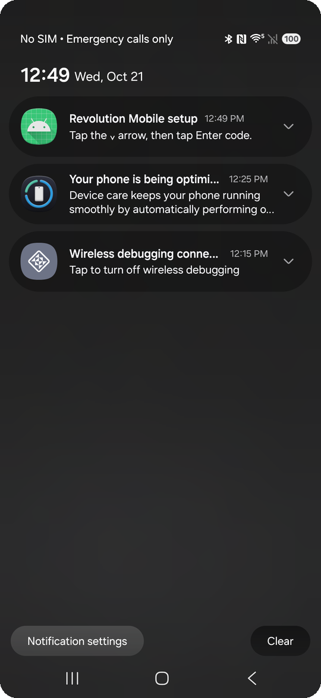
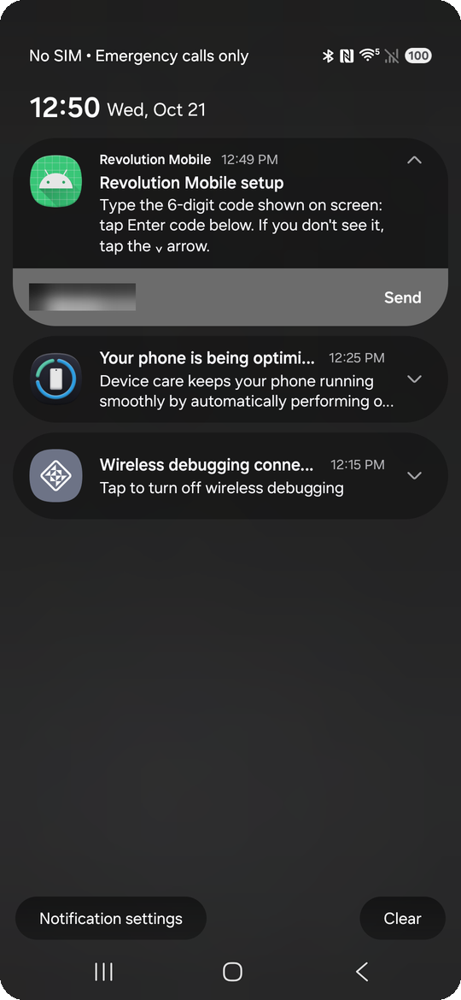
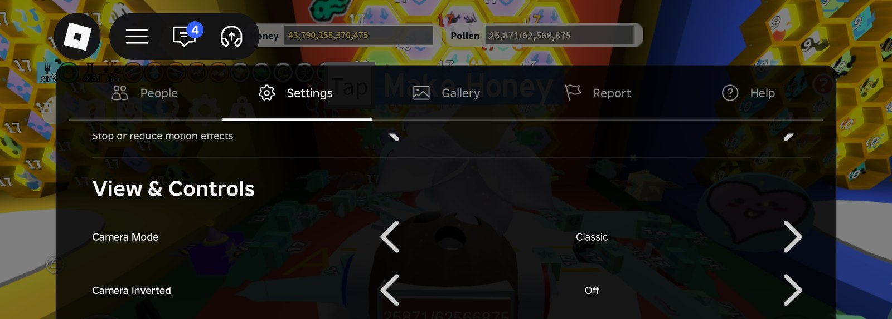
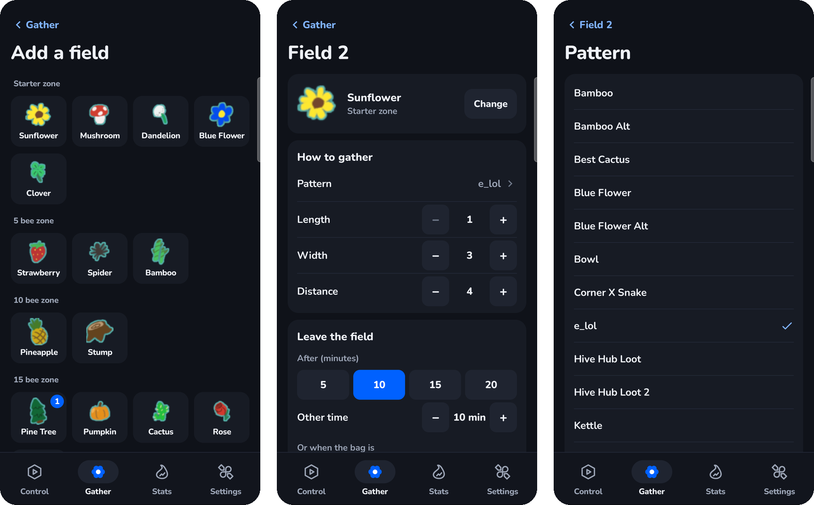
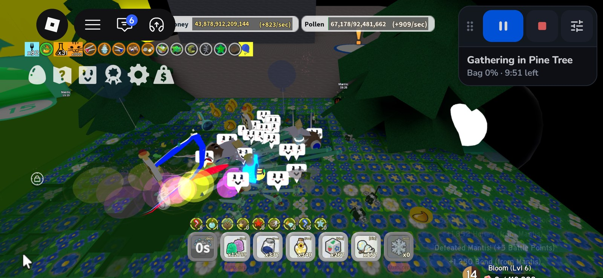
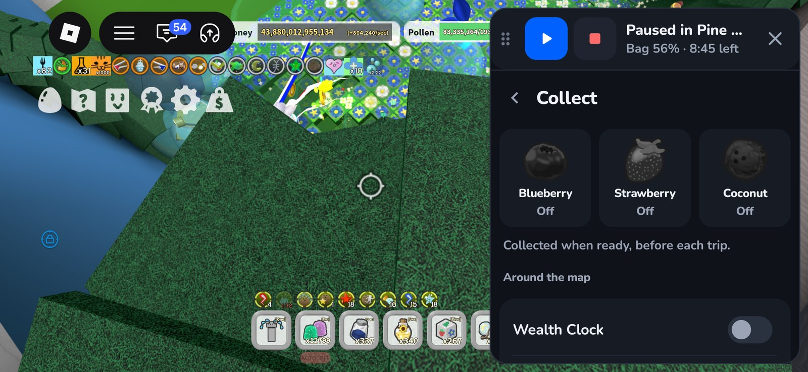

# How to set up Revolution Mobile, the Bee Swarm Simulator macro for Android

This guide takes you from the download to your first field. It works for any Android phone or tablet on Android 11 or newer, with notes for Samsung, Xiaomi, OPPO and OnePlus phones where they differ.

Getting a Bee Swarm Simulator macro to work on Android takes a few more taps than a normal app, because Android doesn't let one app press keys in another. Revolution Mobile does it the official way, with a developer feature called Wireless debugging. You turn it on once and pair the app with your own phone, and after that the app takes care of everything on its own. You don't need a computer or a cable, and none of it roots your phone or changes Roblox.

**On this page:** [Before you start](#before-you-start) · [Install](#1-install-the-app) · [Sign in](#2-sign-in) · [Developer options](#3-turn-on-developer-options) · [Wireless debugging](#4-turn-on-wireless-debugging) · [Pair](#5-pair-the-app-with-your-phone) · [Roblox camera](#6-set-the-roblox-camera) · [Your field and hive](#7-pick-your-field-and-hive) · [Start](#8-start-the-macro) · [After a restart](#after-a-phone-restart)

## Before you start

- Your phone or tablet runs **Android 11 or newer**.
- You're on **Wi-Fi**. Wireless debugging doesn't work on mobile data or a hotspot.
- **Roblox** is installed and you've played Bee Swarm Simulator on this phone at least once.
- You have a Discord or Patreon account to sign in with.

## 1. Install the app

1. On your phone, open the [Releases page](https://github.com/nosyliam/RevolutionMobile/releases/latest) and tap the `.apk` file under **Assets**.
2. When the download finishes, open the file.
3. If Android says your browser isn't allowed to install apps, allow it, then open the file again.
4. Tap **Install**, then **Open**.

Revolution Mobile doesn't come from the Play Store, so Android may warn you about installing it. That warning shows for every app installed from a file.

## 2. Sign in

Tap **Sign in** and choose Discord or Patreon. Your browser opens, you approve the sign-in, and the app comes back on its own.

## 3. Turn on Developer options

The app's **Set up** page shows one step at a time and skips the ones your phone has already done.

1. Tap **Open About phone**.
2. Tap **Build number** 7 times. On a Samsung phone, tap **Software information** first. Enter your lock-screen PIN if Android asks.
3. Go back to Revolution Mobile. The step has a check mark.

  

## 4. Turn on Wireless debugging

1. Tap **Open Developer options**.
2. Scroll to **Wireless debugging** and tap the words, not the switch.
3. Turn it on, then tap **Allow** when Android asks about your Wi-Fi network.

  

## 5. Pair the app with your phone

Pairing is the only fiddly part. Android shows you a 6-digit code, and it closes that code as soon as you switch to another app. So Revolution Mobile puts a small box in your notifications where you can type the code without leaving Settings. Take a minute to read these steps through before you start, and it goes smoothly.

1. In Revolution Mobile, tap **Start pairing**, then **Open Developer options**.
2. Tap **Wireless debugging**, then **Pair device with pairing code**. A window shows a 6-digit **Wi-Fi pairing code**.
3. Stay in Settings and pull down your notifications. Find **Revolution Mobile setup**.
4. If you don't see an **Enter code** button, tap the **⌄** arrow on the notification. Then tap **Enter code**.
5. Type the 6 digits and tap **Send**.

  
  

The notification shows `Pairing…`, then `✓ Paired. Connecting…`, then `✓ Connected`. Go back to Revolution Mobile. It turns on the permissions it needs and starts its input helper by itself, and the first tab changes to **Control**.

You only pair once.

## 6. Set the Roblox camera

The routes to each field are walked with Roblox's classic camera. With any other camera mode, your character curves off the route.

1. Open Bee Swarm Simulator.
2. Tap the Roblox logo, then **Settings**.
3. Set **Camera Mode** to **Classic**.
4. Back in Revolution Mobile, tap **It's set** on the **Control** tab.

  

The macro can also do this for you. Once it's running, open the panel, tap **More**, then **Fix Camera**.

## 7. Pick your field and hive

1. On the **Gather** tab, tap the field to change it, or tap **Add a field**. You can have up to 3, and the macro gathers in the next one each trip.
2. For each field, choose a **Pattern**, how many minutes to gather, and how full your bag gets before you leave.
3. On the **Settings** tab, under **Hive and gear**, set your **Hive slot**, your **Move speed** (your base speed as the game shows it, with no buffs) and your **Sprinkler**.

  

Move speed matters more than it looks. The macro walks its routes by distance, so a wrong speed ends a walk short or long.

## 8. Start the macro

1. On the **Control** tab, tap **Start Macro**.
2. If Android asks whether Revolution Mobile may show over other apps or capture your screen, say yes, then tap **Start Macro** again if you had to leave the app. The macro can't see the game without screen capture, and the floating controls are how you pause and stop it while Roblox is open.
3. The macro opens Bee Swarm Simulator, joins a server, claims a hive and walks to your first field.

  

While it runs, the floating controls show what the macro is doing:

- **Pause** holds the macro where it is. **Resume** carries on.
- **Stop** ends the run.
- The settings button opens the **panel**, where you can change fields, presets, your server and what to collect without leaving the game. Opening the panel pauses the macro, and closing it resumes.

To shut everything down, open the panel, tap **More**, then **Close**. That stops the macro and quits the app. Roblox stays open.

## After a phone restart

Android turns Wireless debugging off when your phone restarts or changes Wi-Fi networks. Open Revolution Mobile and it tells you so, with a button that opens Developer options. Turn Wireless debugging back on and the app reconnects. You don't have to pair again.

Under **Settings › When Wi-Fi drops** you can let the app turn Wireless debugging back on by itself when your Wi-Fi returns.

## Phone-specific settings

Some phones need one more switch. The app shows a **Phone settings** card on the **Control** tab when yours does.

| Phone | Setting |
|---|---|
| Xiaomi, Redmi, POCO | **USB debugging (Security settings)** in Developer options |
| OPPO, OnePlus, realme | **Disable permission monitoring** in Developer options |
| Any phone that slows the macro down on long runs | **Unrestricted battery use** for Revolution Mobile |

## Next steps

- Add a [private server](FAQ.md#do-i-need-a-private-server) so your field is always free.
- Turn on dispensers and boosters under **Collect** in the panel.

  

- Stuck? See [Troubleshooting](TROUBLESHOOTING.md) or ask in the [Discord](https://discord.gg/revolutionmacro).
- The [Revolution Mobile docs](https://revolutionmacro.com/docs/mobile/) go deeper on every setting.

[Back to the README](../README.md)
